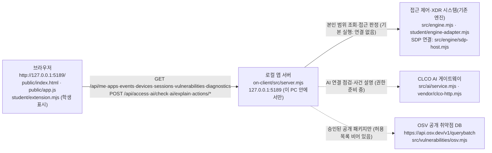

# 케셰브 학생 실행 설명서와 구성도 (21단계)

작성: S13ee · 작성일 2026-10-26 · 대상 소스: 이 문서가 들어 있는 커밋

이 문서는 학생이 새로 작성한 문서입니다. 시작 틀에 들어 있던 제공 문서(`README.md`, `docs/` 아래 기존 문서)는 고치지 않았습니다.

## 0. 표시 규칙

이 문서의 모든 항목에는 확인 방법을 붙였습니다. 확인하지 않은 것을 확인했다고 적지 않습니다.

| 표시 | 뜻 |
|---|---|
| [실행 확인] | 2026-10-26 이 PC에서 직접 실행하거나 화면에서 본 결과 |
| [코드 확인] | 실행하지 않고 저장소의 코드·제공 문서를 읽어서 확인한 내용 |
| [UNV] | 기다림. 운영자 준비 전이라 실제로 확인할 수 없었던 내용 |

## 1. 목적과 기능

케셰브는 회사 직원이 **본인 범위**의 로그인 상태, 업무 앱 접속 판정, 최근 접속 기록·XDR 경보, AI 사건 설명, 조치 처리 상태, 사용 패키지의 알려진 취약점 조회 결과를 한 화면에서 보는 ZTNA·XDR 보안 Agent 앱입니다. [코드 확인: `docs/GETTING_STARTED_STUDENT.md`]

- 메뉴는 「보호 현황」·「업무 앱」·「보안 기록」 세 개입니다. [실행 확인]
- 화면의 각 칸은 **제공** 칸과 **학생 구현 표시**(보라색, `student/extension.mjs`) 칸으로 나뉩니다. [실행 확인]
- 예제(demo)·연결 없음·확인 불가는 실제 연결 성공이 아닙니다. 화면도 그렇게 표시합니다. [실행 확인]

## 2. 필요 프로그램과 확인한 버전

| 프로그램 | 이 PC에서 확인한 버전 | 기준·지원 범위 | 확인 |
|---|---|---|---|
| Node.js | v24.21.0 | 수업 기준 24.19.0, 실행 도구가 받는 범위 22~24 | [실행 확인] `node --version` / 범위는 [코드 확인: `tools/start-alekov.ps1`] |
| npm | 11.19.0 | 외부 npm 의존성 없음(`package.json`에 dependencies 없음) | [실행 확인] `npm --version` / [코드 확인: `package.json`] |
| Git | 2.56.0.windows.2 | 커밋·push 용도 | [실행 확인] `git --version` |
| Windows PowerShell | 버전은 기록하지 않음 | 실행 도구는 `powershell` 명령으로 실행 | [실행 확인] 실행만 확인 |
| 웹 브라우저 | 종류·버전은 기록하지 않음 | `http://127.0.0.1:5189/` 접속 | [실행 확인] 접속만 확인 |

- Node.js가 v24.19.0이 아니면 실행 도구가 `참고: 지금 Node.js 는 v24.21.0 입니다. 수업 기준은 v24.19.0 입니다.`라고 알려 주고 계속 실행합니다. [실행 확인]
- `npm install`은 필요하지 않습니다. 외부 의존성이 없기 때문입니다. [코드 확인: `package.json`, 제공 `README.md`]

## 3. 폴더 구조

Git 저장소의 최상위는 **프로젝트 폴더**이고, 앱 폴더는 그 안의 `on-client`입니다. [코드 확인: `docs/STUDENT_LAUNCH_GUIDE.md` 1장] [실행 확인: `git status`를 프로젝트 폴더에서 실행]

```text
케셰브 방어전/                          ← 프로젝트 폴더(Git 최상위). 커밋·push는 여기서
└─ on-client/                           ← 앱 폴더. 실행 명령은 여기서
   ├─ package.json                      ← 실행 스크립트(start·demo·check)
   ├─ .env.example                      ← 비밀 없는 설정 견본(실제 .env는 저장소에 없음)
   ├─ .on-starter-manifest.json         ← 제공 파일 목록(해시)
   ├─ README.md                         ← 제공 문서
   ├─ docs/                             ← 제공 문서 + 이 학생 문서(STUDENT_RUNBOOK.md)
   ├─ public/                           ← 브라우저 화면(제공): index.html, app.js, style.css,
   │                                       vulnerabilities-view.mjs, ai-connect.mjs, assets/
   ├─ src/                              ← 로컬 앱 서버(제공): server.mjs, engine.mjs,
   │                                       engine/, ai/, connection/, actions/,
   │                                       vulnerabilities/, learner-support/
   ├─ student/
   │  ├─ extension.mjs                  ← 학생이 작성한 화면 표시 코드(13~20단계)
   │  └─ engine-adapter.mjs             ← 제공 연결 어댑터(학생이 고치지 않음)
   ├─ tools/                            ← 실행 도구(제공): start-alekov.ps1 등
   └─ vendor/                           ← CLCO 통신 코드(제공): clco-http.mjs, NOTICE.md
```

[코드 확인: `git ls-files` 결과와 대조]

## 4. 실행·종료·재실행

### 4-1. PowerShell을 여는 위치

앱 폴더(`on-client`)에서 PowerShell을 엽니다.

- 방법 A [실행 확인]: 새 PowerShell 창에서 아래처럼 이동합니다. 이 PC에서는 `projects` 안의 두 번째 폴더(`[1]`)가 `케셰브 방어전`이었습니다. 폴더 순서는 PC마다 다를 수 있으니 이동한 뒤 프롬프트 끝이 `\on-client>`인지 확인합니다.

```powershell
PS C:\Users\Administrator> cd "$env:LOCALAPPDATA\ALEPH\Workbench\projects"
PS ...\projects> cd (Get-ChildItem -Directory)[1].FullName
PS ...\케셰브 방어전> cd on-client
```

- 방법 B [코드 확인: `docs/STUDENT_LAUNCH_GUIDE.md` 2장]: 파일 탐색기에서 `on-client` 폴더를 열고 주소 표시줄에 `powershell`을 입력한 뒤 Enter를 누릅니다.

### 4-2. 실행 전 문법 검사

```powershell
PS ...\on-client> npm run check
```

- 정상 신호: `> node --check student/extension.mjs` 다음에 오류 없이 프롬프트가 돌아옵니다. [실행 확인]

### 4-3. 기본 실행(권장: 실행 도구)

```powershell
PS ...\on-client> powershell -NoProfile -ExecutionPolicy Bypass -File .\tools\start-alekov.ps1
```

정상 시작 신호 [실행 확인]:

```text
참고: 지금 Node.js 는 v24.21.0 입니다. 수업 기준은 v24.19.0 입니다.
케셰브 연결 확인: http://127.0.0.1:5189
케셰브가 켜졌습니다. 브라우저에서 http://127.0.0.1:5189/ 을 여세요.
서버가 응답한 것만 확인했습니다. AI 연결 상태는 화면에서 따로 확인해 주세요.
끄려면 이 창에서 Ctrl+C 를 누르세요.
```

- 첫 줄은 Node.js가 v24.19.0이 아닐 때만 나옵니다. [코드 확인: `tools/start-alekov.ps1`]
- 브라우저 주소: `http://127.0.0.1:5189/` [실행 확인]
- 화면 오른쪽 위 상태: **연결 없음** [실행 확인]. 기존 서버(SDP 엔진)에 연결하지 않은 기본 실행이므로 정상입니다. 이때 빨간 안내와 학생 칸에 `ENGINE_NOT_CONNECTED`가 나옵니다(7장 표).
- `-ExecutionPolicy Bypass`는 이번 한 번의 실행에만 적용되며 PC 설정을 바꾸지 않습니다. [코드 확인: `tools/start-alekov.ps1` 머리말]
- 실행 도구는 Node.js 버전, 폴더, 포트 5189 사용 여부를 먼저 확인합니다. [코드 확인: `tools/start-alekov.ps1`]

### 4-4. 예제 자료로 실행

```powershell
PS ...\on-client> npm run demo
```

- 정상 시작 신호: `케셰브 예제: http://127.0.0.1:5189` [실행 확인]
- 화면 오른쪽 위 상태: **예제 데이터(demo) · 실제 연결 아님** [실행 확인]
- 예제 자료는 화면 모양 확인용이며 실제 연결이나 성취가 아닙니다. [코드 확인: 제공 `README.md`]
- 이 명령은 Node.js 버전·포트를 미리 확인하지 않습니다. [코드 확인: `package.json` 스크립트가 `node src/server.mjs --demo`를 바로 실행]

### 4-5. 그 밖의 실행 방법

| 명령 | 내용 | 확인 |
|---|---|---|
| `npm start` | `node src/server.mjs`. 실행 도구와 같은 서버를 버전·포트 확인 없이 켬 | [코드 확인: `package.json`] |
| 실행 도구 뒤에 ` -Port 5190` | 5189를 다른 프로그램이 쓸 때 다른 포트로 켬. 브라우저 주소도 `:5190` | [코드 확인: `tools/start-alekov.ps1`] |
| 실행 도구 뒤에 ` -Background` | 창 없이 켬. 안내된 프로세스 번호의 node를 작업 관리자에서 끔 | [코드 확인: `tools/start-alekov.ps1`] |
| 실행 도구 뒤에 ` -Demo` | 실행 도구로 예제 모드 실행 | [코드 확인: `tools/start-alekov.ps1`] |
| `-NativeHostConfig`, `-SdpHostConfig` | 담당자가 개인 설정 파일을 안내한 경우에만 사용. 이 프로젝트에서는 쓰지 않았음 | [UNV] |

### 4-6. 종료와 재실행

- 종료: 서버를 켠 PowerShell 창에서 `Ctrl+C`를 누릅니다. 프롬프트(`PS ...\on-client>`)가 다시 보이고, 브라우저에서 새로고침하면 페이지가 열리지 않습니다. [실행 확인]
- 재실행: 같은 창에서 4-3 또는 4-4 명령을 다시 실행합니다. 종료 뒤 같은 창에서 다시 켜지는 것을 확인했습니다. [실행 확인]
- 실행과 종료는 학생 파일을 바꾸지 않습니다. [실행 확인: 앱을 켜고 끈 뒤 `git status`에 실행 때문에 생긴 변경이나 새 파일이 없음]
- 서버를 바꿔 켰을 때 이미 열어 둔 탭의 상태 표시는 바뀌지 않습니다. 새 탭으로 열거나 새로고침합니다. [실행 확인]

### 4-7. 설정 파일(.env)

- 이 프로젝트에서는 `.env`를 만들지 않고 기본값으로 실행했습니다. [실행 확인]
- 견본 `on-client/.env.example`에는 비밀 없는 값만 있습니다: `ON_PORT=5189`, `ON_ENGINE_ADAPTER=./student/engine-adapter.mjs`, `ON_AI_MODEL=aleph/auto`, `ON_PROJECT_DIRECTORY=`(비어 있음), `ON_APPROVED_PUBLIC_PACKAGES=[]`(비어 있음). [코드 확인: `.env.example`]
- 열쇠·토큰·비밀번호는 이 문서와 저장소에 넣지 않습니다.

## 5. 구성도



같은 내용을 글로 적은 표입니다. 실선은 기본 실행에서 실제로 요청이 오가는 연결, 점선은 운영자 준비 전이라 실제 응답을 확인하지 못한 연결입니다.

| 구성 요소 | 실제 파일·주소 | 하는 일 | 이 PC에서의 상태 |
|---|---|---|---|
| 브라우저 | `http://127.0.0.1:5189/`, `on-client/public/index.html`, `on-client/public/app.js` | 화면 틀(제공)을 그리고, `/student/extension.mjs`를 불러와 학생 칸을 그림 | [실행 확인] 화면 표시 |
| 학생 표시 코드 | `on-client/student/extension.mjs` | 서버가 준 상태를 받아 학생 칸 8개를 그림. 서버에 직접 요청하지 않음 | [실행 확인] |
| 로컬 앱 서버 | `on-client/src/server.mjs`, `127.0.0.1:5189` | 정적 파일 제공, `/api/...` 요청 처리. 이 PC(127.0.0.1)에서만 열림 | [실행 확인] 시작 신호·화면 |
| 접근 제어·XDR 시스템(기존 엔진) | `on-client/src/engine.mjs`, `on-client/student/engine-adapter.mjs`, SDP 연결 시 `on-client/src/engine/sdp-host.mjs` | 로그인·기기·세션, 업무 앱 접근 판정, 보안 기록 제공 | 기본 실행: **연결 없음**(`ENGINE_NOT_CONNECTED`) [실행 확인] / 예제 모드: 예제 자료 [실행 확인] / 실제 SDP 연결 [UNV] |
| CLCO AI 게이트웨이 | `on-client/src/ai/service.mjs`, `on-client/vendor/clco-http.mjs` (주소·열쇠는 문서에 적지 않음) | AI 연결 점검, 사건 설명 | 사건 설명 요청 결과 `ON_AI_PROVISIONING_PENDING`(권한 준비 중) [실행 확인] / 실제 설명 성공 [UNV] |
| OSV 공개 취약점 DB | `https://api.osv.dev/v1/querybatch`, `on-client/src/vulnerabilities/osv.mjs` | 승인된 공개 패키지의 정확한 설치 버전으로 알려진 취약점 조회 | `PROJECT_NOT_CONFIGURED` → 학생 칸 `조회 준비 미완료(not_configured)` [실행 확인] / 실제 조회 결과 [UNV] |
| 조치 처리 | `on-client/src/actions/` | 사람 확인 뒤 원천에 조치 전달·결과 조회 | 기본 실행에서는 꺼져 있음(`--alekov-actions`와 설정 파일이 함께 있어야 켜짐) [코드 확인: `src/server.mjs`] / 실제 처리 [UNV] |

## 6. 제공 코드와 학생 작성 부분

- 기준: `on-client/.on-starter-manifest.json`은 시작 틀에 포함된 제공 파일과 그 해시 목록입니다. [코드 확인]
- 학생이 고친 파일은 `on-client/student/extension.mjs` 하나이고, 이번 단계에서 이 문서(`on-client/docs/STUDENT_RUNBOOK.md`)를 새로 추가했습니다. [실행 확인: 단계별 `git show --stat`]
- 같은 `student/` 폴더의 `engine-adapter.mjs`는 제공 파일이며 고치지 않았습니다. [실행 확인: 커밋 기록에 변경 없음]
- 제공 파일(`public/`, `src/`, `tools/`, `vendor/`, `docs/`의 기존 문서, `README.md`, `package.json`)은 고치지 않았습니다.

### 6-1. 학생이 구현한 함수 (`student/extension.mjs`)

| 단계 | 함수 | 보여 주는 것 | 화면 위치 |
|---|---|---|---|
| 13 | `renderIdentity` | 계정·현재 기기·기기 목록·현재 세션·세션 목록과 연결 모드. 실패·확인 불가를 정상처럼 보이지 않음 | 보호 현황 · 학생 구현 표시 |
| 14 | `renderDecision` | 업무 앱 접근 판정(허용·거부·추가 확인 필요·확인 불가)과 요청 실패를 구분. 허용을 앱 접속 성공으로 표시하지 않음 | 업무 앱 · 학생 구현 표시 |
| 15·16 | `renderEvents` | 최근 기록 목록, 종류·업무 앱·접속 상태 필터, 「<사건 ID> 상세」 버튼, 근거·규칙·상태, 지원하지 않는 조치는 「<action> 미지원」 비활성 버튼 | 보안 기록 · 학생 구현 표시 |
| 16 | `renderStatus` | 등록 기기·현재 연결 세션·알림·진단 정보, 「도움정보 복사」(비밀 없는 6개 값만) | 보호 현황 · 학생 상태·알림 표시 |
| 17 | `renderAiConnection` | 앱 안 AI 연결 점검 결과와 오류 코드별 원인 분류 | 보호 현황 · 학생 AI 연결 표시 |
| 18 | `renderExplanation` | 선택한 사건의 AI 요약을 근거 ID·근거 글·규칙·확인 불가 상태와 함께 표시. 근거가 맞지 않거나 실행했다고 답한 설명은 쓰지 않음 | 보안 기록 · 학생 AI 사건 설명 |
| 19 | `renderAction` | 조치 제안·준비·전달 중·접수(ACK)·효과 확인·결과 불명을 구분. 버튼 없음 | 보안 기록 · 학생 조치 상태 표시 |
| 20 | `renderVulnerabilities` | 정확한 설치 버전별 OSV 조회 결과, 미설정·미조회·일부 실패·취소를 "취약점 없음"과 구분, 늦은 응답 차단 | 보호 현황 · 학생 패키지 조회 표시 |

공통 규칙: 화면은 `document.createElement`와 `textContent`로만 만들고, 서버에 요청을 보내거나 자동으로 다시 시도하지 않습니다. 오류 메시지는 첫 줄만, 비밀처럼 보이는 값은 `[가림]`으로 표시합니다. [코드 확인: `student/extension.mjs`]

## 7. 장애별 확인 순서

화면이나 PowerShell 창에 실제로 나오는 문구 기준입니다.

| 화면·창에 나오는 문구 | 원인 | 확인 순서 | 확인 |
|---|---|---|---|
| 오른쪽 위 `연결 없음`, 빨간 안내 "기존 서버·에이전트의 연결을 확인할 수 없습니다. 연결 어댑터를 먼저 확인하세요.", 학생 칸 `연결 실패(error, ENGINE_NOT_CONNECTED)` | 기본 실행에는 기존 엔진(SDP) 연결이 없음 | 1) 실행 도구로 켰는지 확인 → 2) 기본 실행에서는 정상 상태 → 3) 화면 모양만 볼 때는 `npm run demo` → 4) 실제 연결은 담당자의 `-SdpHostConfig` 안내를 기다림 | [실행 확인] |
| `예제 데이터(demo) · 실제 연결 아님` | `npm run demo`로 켬 | 실제 연결 결과가 아님을 확인. 기본 실행으로 다시 켤 때는 `Ctrl+C` 뒤 4-3 명령 | [실행 확인] |
| `포트 5189 를 다른 프로그램이 쓰고 있습니다` | 이전 서버가 켜져 있거나 다른 프로그램이 포트 사용 | 1) 이전 서버 창에서 `Ctrl+C` → 2) 그래도 같으면 실행 도구 뒤에 ` -Port 5190`, 브라우저 주소도 `:5190` | [코드 확인: `tools/start-alekov.ps1`] |
| `npm run demo` 실행 시 `EADDRINUSE` | 같은 포트에 서버가 이미 켜져 있음(`npm run demo`는 포트를 미리 확인하지 않음) | 이전 서버 창에서 `Ctrl+C` 뒤 다시 실행 | [UNV] 이 문서 작성 중 재현하지 않음 |
| `Node.js 가 없습니다` / `지금 Node.js 는 vXX 입니다` | Node.js 없음 또는 22~24 밖 | Node.js 24.19.0 설치 후 새 PowerShell 창 | [코드 확인: `tools/start-alekov.ps1`] |
| `앱 폴더가 아닙니다` / `시작 틀 폴더가 아닙니다` | `on-client` 밖에서 실행 | 프롬프트 끝이 `\on-client>`인지 확인 뒤 다시 실행 | [코드 확인: `tools/start-alekov.ps1`] |
| 학생 칸 `AI 설명 실패: 학생 앱 이용 권한의 발급·연결을 준비 중입니다. 담당자에게 확인하세요. (error, ON_AI_PROVISIONING_PENDING)`, `실패 이유: 앱 권한 준비 중` | 운영 측 AI 앱 권한 준비 전 | 1) 학생 설정 오류가 아님 → 2) 버튼을 반복해서 누르지 않음 → 3) 담당자에게 확인. 기록과 업무 앱 판정은 그대로 사용 | [실행 확인] |
| 학생 칸 `전체 조회 상태: 조회 준비 미완료(not_configured)` (제공 칸 코드 `PROJECT_NOT_CONFIGURED`) | 조회 대상 프로젝트·허용 패키지가 설정되지 않음(운영자 준비 사항) | 취약점 없음이 아님. 학생이 설정을 바꾸지 않고 담당자 준비를 기다림 | [실행 확인] |
| 학생 칸 `조회 취소됨(error, CANCELLED)` | 「패키지 조회 취소」를 누름 | 취소 결과는 취약점 없음이 아님. 다시 조회는 「설치 패키지 조회」를 직접 누름 | [코드 확인: `public/app.js`, `student/extension.mjs`] |
| `확인 불가(unknown)`, `CONTRACT_MISMATCH`, `ENGINE_RESULT_UNVERIFIED` | 응답 형식이 계약과 다르거나 확인 불가 | 정상·빈 목록으로 보지 않음. 「다시 불러오기」를 한 번 직접 누르고, 계속되면 「도움정보 불러오기」 내용을 확인해 담당자에게 | [코드 확인: `docs/CONNECTION_TROUBLESHOOT.md`] |

그 밖의 오류 코드(계정 연결 `NATIVE_*`, AI 앱 승인 `ALEKOV_CONNECT_*`, AI 점검 `WB_CLCO_*`)는 제공 문서 `docs/CONNECTION_TROUBLESHOOT.md`의 표를 따릅니다. 도움정보는 「보호 현황」의 「도움정보 불러오기」 → 내용 확인 → 「확인했으며 복사합니다」 순서로 직접 복사하며, 자동으로 보내지지 않습니다. [코드 확인: `docs/STUDENT_LAUNCH_GUIDE.md` 5장]

## 8. 확인한 기능과 기다림(UNV)

### 8-1. 이 PC에서 확인한 것

| 기능 | 결과 | 확인 |
|---|---|---|
| 문법 검사 `npm run check` | 오류 없음 | [실행 확인] |
| 실행 도구로 기본 실행·종료 | 시작 신호, 화면 표시, `Ctrl+C` 종료 | [실행 확인] |
| `npm run demo` 실행·종료 | 시작 신호, 예제 화면, 종료 뒤 접속 안 됨 | [실행 확인] |
| 13단계 계정·기기·세션 칸 | 기본 실행: `연결 없음(disconnected)`과 `ENGINE_NOT_CONNECTED` / 예제: 예제 사용자·기기(`확인 불가(unknown)`)·세션(`활성(active)`) | [실행 확인] |
| 14단계 업무 앱 칸 | 예제 모드 요청 전 `앱을 골라 접속을 요청하세요(idle)` | [실행 확인] |
| 15단계 보안 기록 칸 | 예제 기록 `event-01` 목록과 상세(근거 `e-01`, 규칙 `rule-01`, 기기 `확인 불가(unknown)`) | [실행 확인] |
| 16단계 상태·알림 칸 | 예제 기기·세션·알림 2건, 진단 정보 `아직 불러오지 않음(idle)` | [실행 확인] |
| 17단계 AI 연결 칸 | 점검 전 `AI 연결 점검 전(idle)` | [실행 확인] |
| 18단계 AI 사건 설명 칸 | 기록 선택 전 `보안 기록에서 기록을 먼저 고르세요`, 설명 요청 결과 `ON_AI_PROVISIONING_PENDING` 실패 표시 | [실행 확인] |
| 19단계 조치 상태 칸 | `아직 미실행(idle)`, 버튼 없음 | [실행 확인] |
| 20단계 패키지 조회 칸 | `조회 준비 미완료(not_configured)`, 0건을 취약점 없음으로 보이지 않음 | [실행 확인] |

### 8-2. 기다림(UNV): 실제로 확인하지 못한 것

| 항목 | 이유 |
|---|---|
| 기존 엔진(SDP) 실제 연결: 실제 사용자·기기·업무 앱 판정·기록 | 개인 SDP 설정 파일 미발급 |
| 14단계 실제 접근 판정 결과 화면 | 이 문서 작성 중에는 요청하지 않음. 실제 판정은 SDP 연결 전 |
| 17단계 AI 연결 성공·모델 점검 성공 | 운영 측 앱 권한 준비 중 |
| 18단계 실제 AI 사건 설명 성공 화면 | 운영 측 앱 권한 준비 중(`ON_AI_PROVISIONING_PENDING`) |
| 19단계 조치 준비·집행·결과 조회 | 지원 조치 없음(supportedActions 빈 배열), 조치 처리 연결 전 |
| 20단계 실제 OSV 조회 결과 행 | 조회 대상 설정·허용 목록 비어 있음 |
| 20단계 취소 뒤 늦은 응답 차단 화면 | 조회가 빨리 끝나 화면에서 재현하지 못함. 모의 입력으로만 점검 |
| 18~20단계 성공·부분 결과 표시 | 실제 데이터 없음. 모의 입력(jsdom)으로만 점검 |
| `-Port`, `-Background`, `npm start` 단독 실행 | 이 문서 작성 중 실행하지 않음 |
| Windows PowerShell·브라우저 버전 | 기록하지 않음 |

## 9. 지원하지 않는 환경과 하지 않는 것

- Node.js 22 미만·24 초과는 실행 도구가 실행하지 않습니다. [코드 확인: `tools/start-alekov.ps1`]
- 앱 서버는 `127.0.0.1`에서만 열리며 다른 PC에서 접속하는 용도가 아닙니다. [코드 확인: `src/server.mjs`]
- 예제 모드와 SDP 연결은 함께 쓸 수 없습니다. [코드 확인: `src/server.mjs`, `tools/start-alekov.ps1`]
- 학생 화면은 조치를 실행하지 않고, 주소·열쇠 입력 칸을 만들지 않습니다. [코드 확인: `student/extension.mjs`]
- macOS·Linux에서의 실행은 확인하지 않았습니다.
